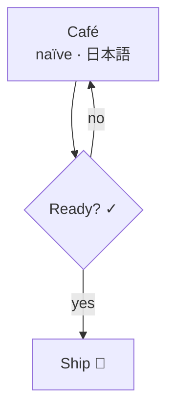
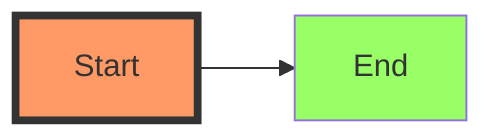
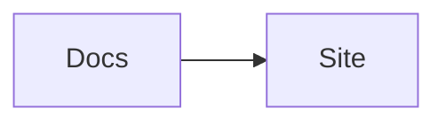
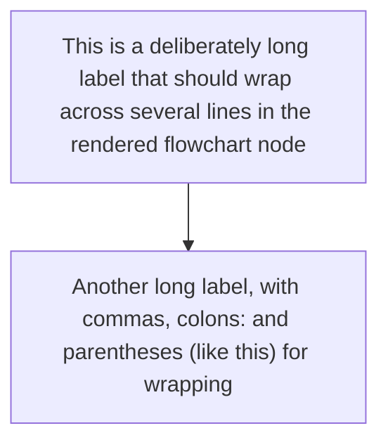
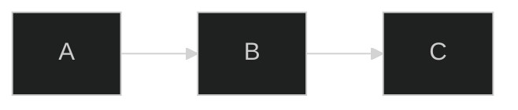
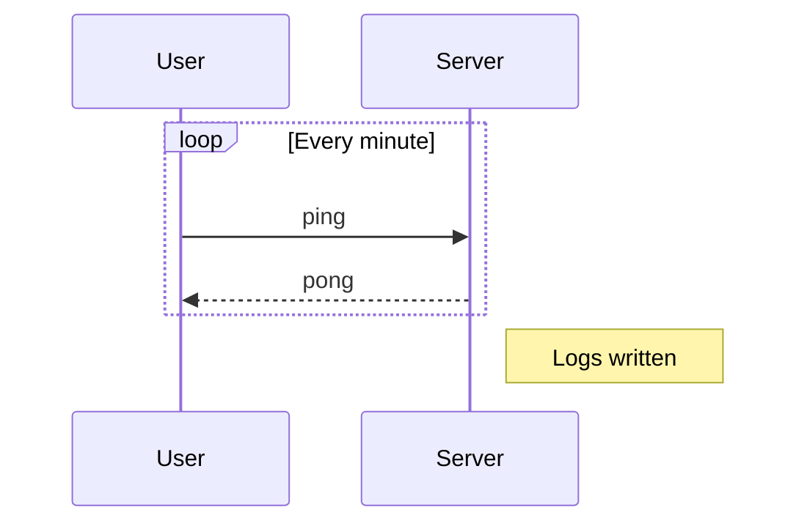
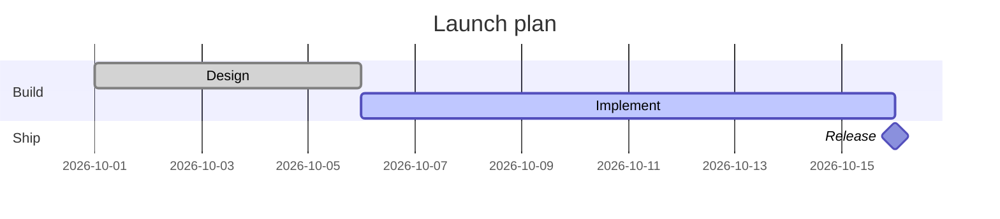
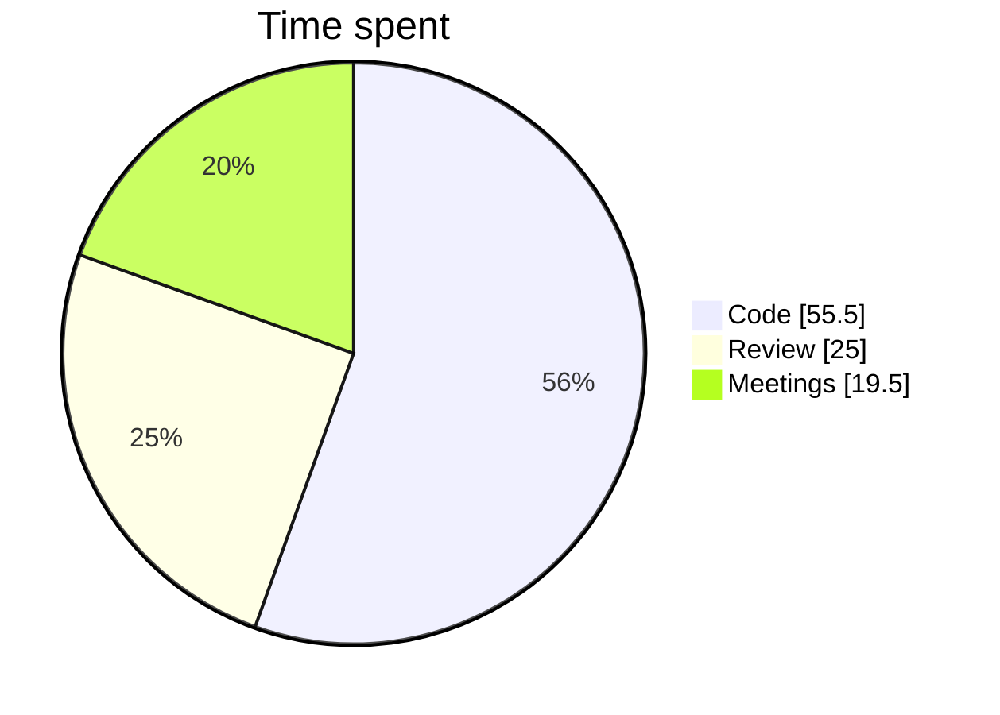

# Extra Mermaid cases

Cases beyond Ondine's examples: HTML labels, Unicode, styling, links, long labels, and config frontmatter.

## Flowchart with HTML and Unicode labels

## Styled flowchart

## Strict security: click and links

## Long labels wrap

## Frontmatter theme and config

## Sequence with notes and loops

## Gantt with sections and milestones

## Pie with percentages

