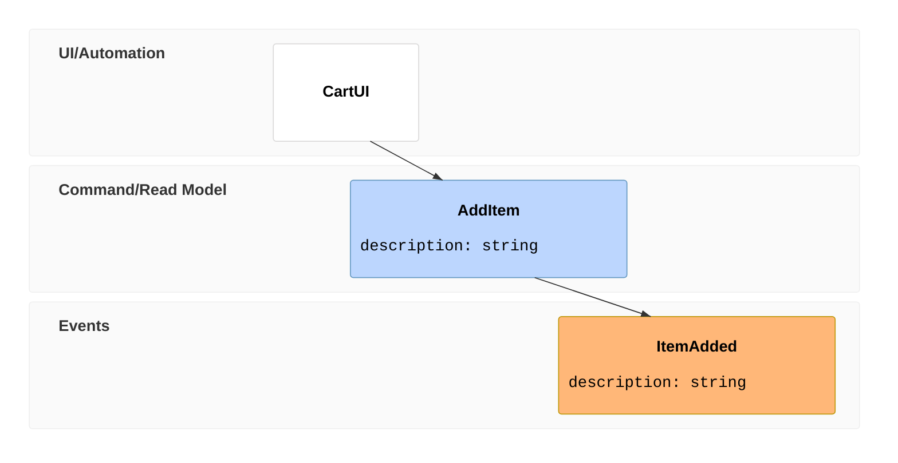
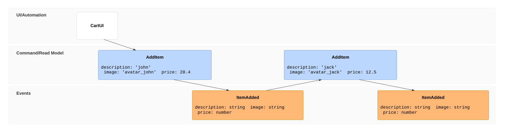
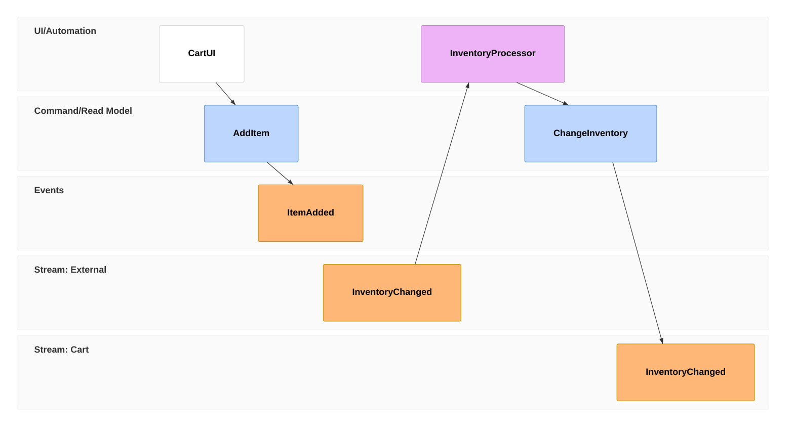
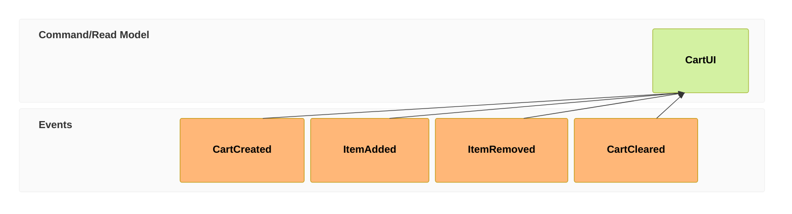

# Eventmodeling examples

Every example from Ondine's `site/src/content/docs/diagrams/{name}.mdx`, unchanged.

## Example 1

## Example 2

## Example 3

## Example 4

## Example 5

## Example 6

